# Awesome Field Audit Trail & History 🛡️🔍

  

  
  
  
  
  

## 🚀 Top Field Audit Trail & History Ecosystem

**Curated List of Enterprise SaaS Platforms & Open-Source GitHub Projects** 📚✨  
*Focused on Field-Level Change Tracking, Immutable Audit Trails, Data Retention & Compliance Archiving.*

> **Last updated: March 2026** 📅

---

### 💡 Overview & SEO Guide 🔍

Welcome to the definitive guide and directory for **Field Audit Trail**, **Field History Tracking**, **Immutable Audit Logging**, and **Long-Term Compliance Archiving**.

In modern regulated enterprises, standard out-of-the-box system history is severely limited—often capped at 18 to 24 months, restricted to a few dozen fields, or vulnerable to unauthorized administrative modification. **Field Audit Trail & History** solutions empower compliance officers, Salesforce administrators, security engineers, and data architects to:
- 🕒 **Track Field-Level Changes:** Capture every granular before-and-after attribute modification, author identity, timestamp, and transaction context.
- 📜 **Enforce Long-Term Retention:** Preserve historical records for 5 to 10+ years to satisfy stringent statutory retention requirements (**SOX**, **HIPAA**, **GDPR**, **21 CFR Part 11**, **SEC Rule 17a-4**, **PCI DSS**).
- 🔐 **Guarantee Cryptographic Integrity:** Deploy write-once-read-many (WORM) storage, Merkle tree ledgers, and cryptographic hash chains to prove data has remained tamper-free during forensic investigations.
- ⚡ **Optimize Storage & Performance:** Offload cold history and massive operational logs into cost-efficient, queryable cloud data lakes and Big Objects without degrading transactional application throughput.

---

## 📑 Table of Contents

- [🌐 Sector Overview & Market Dynamics](#-sector-overview--market-dynamics)
- [☁️ SaaS & Commercial Hosted Platforms](#️-saas--commercial-hosted-platforms)
- [🔓 Open-Source GitHub Projects](#-open-source-github-projects)
- [🏗️ Building Custom Self-Hosted Architectures](#️-building-custom-self-hosted-architectures)
- [🤝 How to Contribute](#-how-to-contribute)
- [⚖️ Disclaimer](#️-disclaimer)
- [💖 Support & Community](#-support--community)
- [⭐ Star History](#-star-history)

---

## 🌐 Sector Overview & Market Dynamics 📊

The global **Enterprise Data Archiving, Field Audit Trail, and Regulatory Compliance Software** market is currently estimated at **$8.4 Billion** and is projected to surpass **$16.8 Billion by 2030**, advancing at a compound annual growth rate (CAGR) of **~12.2%**. This accelerated growth is propelled by escalating statutory compliance penalties, pervasive ransomware threats, and widespread enterprise migration toward cloud CRM and ERP platforms where unalterable audit trails are mandatory.

From a structural standpoint, the sector exhibits **moderate fragmentation**:
- **Platform Concentration:** High market concentration exists around tier-1 cloud ecosystem anchors—most notably **Salesforce Shield**, **Veeam**, and **Commvault**—which command massive enterprise install bases for operational CRM, virtualized infrastructure, and core database backups.
- **Specialized & Multi-Cloud Fragmentation:** Significant fragmentation persists across multi-cloud environments, Bring-Your-Own-Cloud (BYOC) data lakes, and specialized regulatory niches. Organizations frequently complement anchor platforms with specialized enterprise archivers (such as **Own**, **Odaseva**, and **Keepit**) or deploy vendor-neutral open-source tamper-evident ledgers (such as **immudb**, **Debezium**, and **OpenMetadata**) to maintain sovereign, portable audit records free from vendor lock-in.

---

## ☁️ SaaS & Commercial Hosted Platforms

This table lists enterprise SaaS platforms and managed archiving solutions for Field Audit Trail, change tracking, and compliance archiving.

All platforms are sorted descending by **Company Scale (Annual Revenue / Market Valuation)** 📈:

| Product / Platform | Company Scale (Revenue / Valuation) 📈 | Description 📝 | Pricing 💰 | Free Tier / Trial Limits ⏳ |
| :--- | :--- | :--- | :--- | :--- |
| **[Salesforce Shield Field Audit Trail](https://help.salesforce.com/s/articleView?id=platform.shield_ext_history_retention.htm&type=5)** | **~$38.50 Billion** (FY25 Annual Revenue; ~$280B Market Cap) | Extends native field history tracking from standard 18 months up to 10 years. Automates retention policies for up to 60 standard/custom fields per object using Big Objects. Critical for SOX, HIPAA, and regulatory compliance. | **10% of net Salesforce license spend** (or 30% for complete Salesforce Shield suite; requires Enterprise, Performance, or Unlimited Edition). | **Free standard field tracking forever** (up to 20 fields per object retained for 18 months); 30-day Enterprise sandbox trial with Shield enabled upon account team request. |
| **[Own Archive (formerly OwnBackup)](https://www.owndata.com/)** | **~$1.90 Billion** (Acquired by Salesforce for $1.9B in 2024; prior $3.35B valuation) | Enterprise SaaS data protection and archiving platform. Features customizable retention policies (daily backups up to 10 years, monthly up to 99 years) with keyword-searchable historical record discovery. | Starts at **~$3.45/user/month** (subject to an enterprise minimum commitment floor of ~$1,000/month or $12,000/year). | **30-day proof-of-concept / sandbox trial** with full data backup and archiving capabilities; no permanent free tier. |
| **[Veeam Archive / Veeam Data Cloud](https://www.veeam.com/)** | **~$1.50 Billion** (Annual Recurring Revenue; Insight Partners backed ~$5B valuation) | Enterprise data resilience suite supporting automated tiering to low-cost immutable cloud storage (AWS Glacier, Azure Archive) with specialized protection for Salesforce and Microsoft 365. | Starts at **~$155/workload/year** (~$12.90/workload/month for VUL) or **~$1.50–$3.00/user/month** for SaaS M365/Salesforce; Vault Archive storage starts at **~$0.012/GB/month**. | **Veeam Community Edition is free forever** (up to 10 workloads with full backup capabilities); 30-day full-featured enterprise trial (14-day trial for Veeam Data Cloud SaaS). |
| **[Commvault Cloud](https://www.commvault.com/)** | **~$900 Million** (Annual Revenue; ~$6 Billion Public Market Cap) | Azure-native cyber resilience platform providing air-gapped, immutable data protection, rapid point-in-time forensic restores, and tamper-resistant audit logging against malicious modifications. | Starts at **~$1.70–$4.50/user/month** for SaaS endpoints or **~$58.50/TB/month** for cloud storage workloads via Azure Marketplace. | **30-day free trial** with up to 30,000 trial credits on Microsoft Azure Marketplace / Commvault Cloud portal; no permanent free tier. |
| **[Spanning Archive](https://spanning.com/)** | **~$450 Million** (Enterprise unit scale within Kaseya's ~$1.5B IT management portfolio) | Automated cloud data protection suite for Salesforce, Microsoft 365, and Google Workspace, delivering granular point-in-time recovery, ransomware defense, and audit status monitoring. | Starts at **$48/user/year** (~$4.00/user/month) with unlimited storage and retention included in base tier. | **14-day free trial** with full feature access and unlimited backup/restore testing; no permanent free tier. |
| **[Odaseva Data Retention](https://www.odaseva.com/)** | **~$250 Million** (Enterprise Valuation; $90M+ total raised including $54M Series C in 2024) | Enterprise Salesforce data platform automating 2, 5, 7, and 10-year retention policies across complex parent-child relational schemas with automated sandbox data anonymization. | Professional Edition starts at **$5,000/year** (or ~$1,000–$1,750/month per company on Salesforce AppExchange for enterprise archiving). | **DailyExport.io free tier forever** (automated daily Salesforce backups up to 50k records/object with 30-day retention); 30-day enterprise sandbox evaluation upon request. |
| **[Keepit Archive](https://www.keepit.com/)** | **~$100 Million** (Enterprise Valuation; $30M+ funding; leading independent European backup cloud) | Vendor-neutral cloud data protection platform featuring a guaranteed 10-year retention model, tamper-proof blockchain-inspired storage architecture, and historical snapshot searches. | Starts at **~$2.00–$4.00/user/month** (e.g. ~$3.50/user/month for Enterprise / Governance tier with 10-year retention guarantee and all storage included). | **30-day full-featured free trial** with unlimited storage and retention testing; no permanent free tier. |
| **[Flosum Audit Trail](https://www.flosum.com/)** | **~$50 Million** (Enterprise Valuation; $35M growth equity investment from Sundance Investments) | Salesforce-native DevSecOps and release management platform maintaining an unalterable history of metadata and component changes to detect unauthorized out-of-band modifications. | Starts at **~$1,600–$2,265/month** (~$19,200–$27,180/year median contract value based on environment/sandbox counts). | **30-day free sandbox trial** via Salesforce AppExchange; no permanent free tier. |
| **[AutoRABIT Vault](https://www.autorabit.com/)** | **~$40 Million** (Enterprise Valuation; $40M+ institutional funding) | Salesforce data protection and archival suite supporting Big Objects, date-range masking, and automated compliance archiving for HIPAA and GDPR enforcement. | Starts at **~$1,250/month** (~$15,000/year baseline enterprise contract per production Salesforce org). | **14-day to 30-day proof-of-concept sandbox trial** upon sales request; no permanent free tier. |
| **[GRAX](https://www.grax.com/)** | **~$25 Million** (Enterprise Valuation; Series A/B funded BYOC data platform) | Bring-Your-Own-Cloud (BYOC) data platform replicating 100% of Salesforce history, metadata, and files into Parquet format directly in customer-owned AWS or Azure cloud storage. | Starts at **~$48,000/year** (or ~$2,500/month AppExchange tier) + ~$250–$400/month customer cloud compute (AWS/Azure). | **7-day to 30-day proof-of-concept trial** deployed in customer cloud; historical "GRAX Lite" tier limited to 1 weekly backup; no permanent free tier. |

---

## 🔓 Open-Source GitHub Projects

This section features open-source libraries, immutable databases, Change Data Capture (CDC) systems, and compliance frameworks for building custom, transparent, and vendor-neutral audit trails.

All projects are sorted descending by **GitHub Star Count** ⭐ and feature white social star badges linking directly to each repository's stargazers page:

1. **[n8n](https://github.com/n8n-io/n8n)**   
   Fair-code workflow automation platform with visual node-based pipelines for automated audit trail exports, compliance webhook ingestion, and event-driven data archival.

2. **[Nextcloud Server](https://github.com/nextcloud/server)**   
   Open-source collaboration and storage platform with built-in activity tracking, comprehensive administrative audit logging, and automated file retention rules.

3. **[Wazuh](https://github.com/wazuh/wazuh)**   
   Unified open-source security monitoring, File Integrity Monitoring (FIM), and SIEM platform with out-of-the-box regulatory compliance mapping for PCI DSS, GDPR, and HIPAA.

4. **[OpenMetadata](https://github.com/open-metadata/OpenMetadata)**   
   Centralized metadata management platform featuring complete data lineage, change event tracking, and end-to-end field-level audit histories.

5. **[OpenSearch](https://github.com/opensearch-project/OpenSearch)**   
   Community-driven search and analytics suite offering immutable index lifecycle management (ISM), security audit logging, and compliance cold storage snapshotting.

6. **[Debezium](https://github.com/debezium/debezium)**   
   Distributed Change Data Capture (CDC) platform built on Apache Kafka that captures every database row and field modification in real time into an immutable event log.

7. **[DataHub](https://github.com/datahub-project/datahub)**   
   Extensible metadata platform tracking versioned entity timelines, schema modification histories, and enterprise governance audit trails.

8. **[immudb](https://github.com/codenotary/immudb)**   
   Lightweight, ultra-fast immutable database with built-in cryptographic Merkle-tree verification, tamper-evident revision history, and zero-trust audit capabilities.

9. **[PaperTrail](https://github.com/paper-trail-gem/paper_trail)**   
   The industry-standard ActiveRecord change tracking gem in Ruby on Rails. Stores full historical versions, user attribution, and field-level diffs for every update and deletion.

10. **[Django Simple History](https://github.com/jazzband/django-simple-history)**   
    Comprehensive Django auditing package that records every model modification, change reason, and requesting user to create a complete database audit trail.

11. **[Apache Atlas](https://github.com/apache/atlas)**   
    Scalable metadata management and governance system providing end-to-end data lineage, audit logging, and classification for big data pipelines.

12. **[Javers](https://github.com/javers/javers)**   
    Lightweight Java/Spring object auditing and diffing framework that records snapshots, field-level change histories, and commit authors in SQL/NoSQL databases.

13. **[Auditd](https://github.com/linux-audit/audit-userspace)**   
    Linux kernel audit subsystem user-space tools for capturing security events, system calls, and file-level modifications at the operating system layer.

14. **[Historify](https://github.com/flosommerfeld/Historify)**   
    CLI tool for revision-safe file change tracking using BLAKE3 and SHA-256 cryptographic hash chains with minisign verification for tamper-evident storage auditing.

15. **[regulog](https://github.com/repro-stats/regulog)**   
    R package for regulated audit trails in life sciences. Uses SHA-256 hash chains to ensure unalterable field-level records compliant with **21 CFR Part 11** and EU Annex 11.

---

### 🏗️ Building Custom Self-Hosted Audit Architectures 🛠️

For organizations building sovereign, on-premise, or private-cloud audit solutions without commercial SaaS lock-in:
- **Streaming Change Capture:** Use **Debezium** on Apache Kafka to capture database mutations without modifying application source code.
- **Cryptographic Tamper-Evidence:** Store audit commitments in **immudb** to mathematically guarantee no historical field record has been altered.
- **Lineage & Governance:** Connect **OpenMetadata** or **DataHub** to map downstream data lineage and visualize historical schema transformations.
- **File & Storage Integrity:** Deploy **Wazuh** or **Historify** alongside **Nextcloud** for file integrity auditing and long-term regulatory compliance.

---

## 🤝 How to Contribute

Contributions are welcome! Help us keep this directory exhaustive and up to date:

1. Fork the repository.
2. Add or update entries in `README.md` following the established format.
3. For SaaS entries, include verified pricing and specific free tier/trial limits.
4. For open-source projects, include the white social star badge linking to the repository stargazers page.
5. Submit your PR with a clear, concise description!

Check out our curated master list of awesome lists at [Awesome-Awesome-Awesome](https://github.com/ishandutta2007/Awesome-Awesome-Awesome)! 🌟

---

## ⚖️ Disclaimer

- This repository is a **community-curated directory** provided for informational, educational, and architectural guidance.
- Audit trail, forensic, and history solutions handling regulated records must be audited independently to verify compliance with jurisdiction-specific standards (**SOX**, **HIPAA**, **GDPR**, **21 CFR Part 11**, **SEC Rule 17a-4**, **PCI DSS**).
- Self-hosted open-source implementations require proper cryptographic key ceremonies, immutable storage configurations, and proactive monitoring to ensure forensic validity.

---

## 💖 Support & Community

If this curated guide saved you time or accelerated your enterprise audit trail & compliance roadmap, please consider supporting its development:

- ⭐ **Star this repository** on GitHub to show your appreciation and help others discover it!
- 🍴 **Fork and share** it with fellow developers, compliance officers, and Salesforce administrators.
- ☕ **Buy me a coffee / Sponsor:** Support ongoing maintenance and new features through the [GitHub Sponsors Dashboard](https://github.com/sponsors/ishandutta2007).

Every bit of support helps keep open-source research thriving! ✨

---

##  Star History

---

  <b>Made with ❤️ for compliance officers, Salesforce administrators, IT governance teams, and security engineers.</b> 
  Let's make Field Audit Trail &amp; History transparent, tamper-proof, and accessible to everyone.

